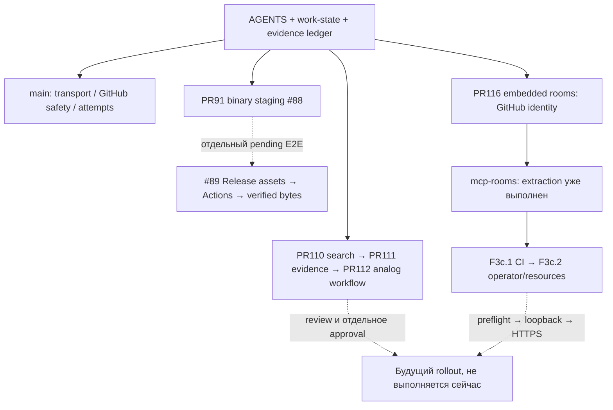

# mcp-server — передача проекта новому ИИ

Это индекс достигнутого в данном чате и уже сохранённых первичных наработок, не
новая копия runtime. Читать [AGENTS](../AGENTS.md), [work-state](work-state.json),
[полный ledger](chat-progress.md), [карту](project-map.md), затем точные ссылки.
Снимок репозитория: main `8c2aa3ac6972e680cd9df7af982e66731d21f2ce`; снимок не live VPS probe.

## Зачем существует проект

Модульный MCP Streamable HTTP/JSON-RPC сервер: GitHub/Actions/files/PRs, bounded
диагностика, optional localfs/localgit/shell/process, web/utils/Synapse. Отдельная
важная пользовательская цель — находить полезные коммерческие идеи и идейные
аналоги любого своего repo (Agora, Tablebot, ConstruBot), не только популярные
репозитории и не только совпадение слов. Поиск → pinned source → механизм →
ограниченный вывод о пригодности/лицензии, а не автоматически «клон»/готовая замена.

## Главная ловушка: несколько состояний одновременно

- Main не содержит все результаты. **Не повторять реализацию**, прежде прочитать
  PR #87/#91/#107–112/#114/#116 и ветки в ledger.
- Установленный TEST был composite поверх TEST, а не HEAD одной старой ветки.
  Последний operator-report: rooms composite `3c4eb8405c413a49374a17b73c973dbb9aeda9a6`,
 128 tools, rooms source `75555c3ebee335a151be3ebdcb6af2bfdc0b767a`.
  Это исторический отчёт; свежую ревизию/флаги нужно отдельно проверять.
- Production старого сервера и standalone Rooms — разные сервисы. Документация
  production здесь датированная; не обновлять её выводами о новом Rooms TEST.
- Source/CI != установленный TEST != независимая authenticated acceptance != PROD.
- Есть упоминание доработок в другом чате; его private context не получен. Этот
  снимок не удостоверяет полноту относительно всех параллельных изменений.

## Выполнено и где продолжать

1. **Надёжность GitHub/Actions:** guards expected SHA, modes, bounds, attempts/log
   readers, false-success fixes; подробности в main docs и tests. Не переписывать.
   Artifact-attempt acceptance #87 отдельно; пустой grep не означает успех.
2. **#88 binary staging:** код, тесты, guarded helpers и реальные малые upload/ZIP/
   XLSX/count-quota проверки сохранены в #91. Cross-owner/TTL/byte quotas/host
   retention/~41MiB и #89 E2E не закрыты. Маршруты временные, не включать снова без
   разрешения. UTF-8 legacy binary-file method не универсальный upload.
3. **Поиск аналогов:** #110 search observations → #111 pinned public evidence →
   #112 композиция `find_repository_analogs`. Есть продолжения/fingerprints,
   zero-star/forks, bounded requests/bytes, явный quota stop. Четыре live кейса
   сохранены. Исправление explicit-path walk в TEST установлено, но последняя
   ConstruBot приёмка остановилась на quota, не на доказанном успехе чтения файла.
4. **#115/#116 embedded rooms:** восемь SQLite rooms_* на том же endpoint, hardening,
   cursor/idempotency/ACL, restart; два GitHub owners подтверждены. Third-owner
   negative/live full restore/load/off-host/prod gates ещё открыты.
5. **#117 extraction уже сделан:** public MIT `LeonidYasin/mcp-rooms`, PR #1. UUID
   identities без GitHub, индивидуальные digest-only credentials; Qwen↔Notion через
   локальный прокси действительно проверен; временный standalone TEST затем
   остановлен. Новый marketplace разработан там, не в этом сервере.
6. **Standalone текущая граница:** docs HEAD `c92d5036c7dc6c8686d31cbb14dc72c1f7369798`, принятый source
   `fc96fe641092b1cfc07c6fa25cc2d3a65d0a88ac`,789 tests Python3.12 и hash-locked
   offline wheelhouse. Не installer/VPS production. Продолжать там F3c.2.

## Рекомендуемая последовательность для следующего server-чата

1. Сверить branch/PR HEAD и diff с machine state; не затирать новые изменения.
2. Если продолжается поиск — взять точный незавершённый ConstruBot read из ledger
   после quota reset через обычные MCP read tools (не shell), проверить pinned
   tree/blob/path/lines и сохранить честный outcome. Не нужен новый rollout, если
   verified runtime действительно содержит path-walk fix.
3. Улучшать информативность evidence и ранжирование по конкретному механизму с
   reviewed cases/false positives; schema/coverage/budget contracts сохранить.
   Следующий небольшой coding gate — continuation/coverage ledger и измеримый
   task-specific evaluation; не обещать глобальную semantic recall.
4. Отдельно reviewer решает merge order/совместимость #110→#111→#112 и #116. Не
   cherry-pick пересекающиеся feature branches вслепую. Любой rollout — новая заявка.
5. Если задача не research, выбрать ОДИН pending gate #88/#89/#87 или embedded rooms
   из ledger; source/CI/live acceptance разделять и обновлять README/ROADMAP.

Текущее поручение владельца: сначала сохранить этот server-handoff, затем работать
над MCP Rooms. Server-код/merge/deploy данным поручением не исполняются.

## Граф продолжения и зависимостей

Пунктир — незавершённая/разрешаемая зависимость, не доступный endpoint.
[Проверка handoff и границы CI](handoff-validation.md).
