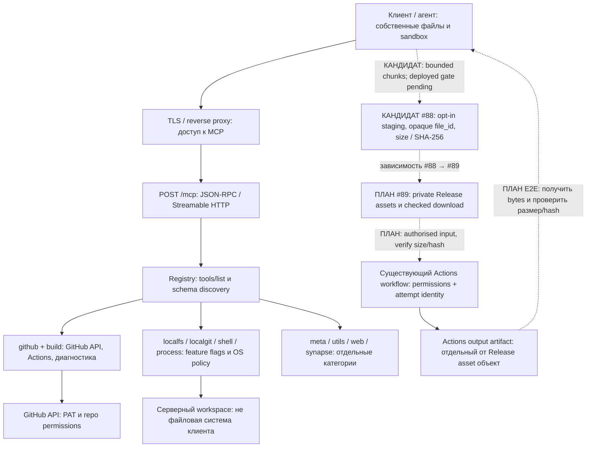

# Карта проекта mcp-server

Ревизия документации 9 · 2026-10-15. Источник для карты — этот файл; обновлять вместе с [ROADMAP](../ROADMAP.md), [README](../README.md), [TOOLS](../TOOLS.md) и [файловым планом](binary-transfer-plan.md). Это карта кода и backlog; датированный production rollout и отдельный TEST-кандидат подтверждены в [снимке окружений](deployment-status.md).

## Архитектура и границы доверия



Сплошные связи обозначают существующие компоненты, **не** доказанную доступность всех методов при любых флагах/правах. Пунктир — запланированный сквозной маршрут, который ещё не принят end-to-end; #88 теперь opt-in кандидат, #89 остаётся планом. Если Mermaid не поддерживается, тот же план читается так:

```text
Сейчас: клиент → TLS/proxy → MCP transport → registry → GitHub API / локальные категории
План:   клиентские bytes → #88 staging(file_id, size, SHA-256)
                         → #89 private Release asset → Actions → output artifact
                         → полученные клиентом bytes + проверенные size/SHA-256
```

`/data/...` клиента ≠ `/home/...` VPS. Server-local fixture не доказывает передачу из клиента. `artifact_id`, `release_id`, `asset_id` и staging `file_id` не взаимозаменяемы. Нельзя передавать GitHub PAT на storage/CDN или публиковать signed URL в документации.

## Состояние по направлениям

| Направление | Реализовано / ограничение | Следующая работа |
| --- | --- | --- |
| GitHub files/PR/status/process | Исправления bounds, modes, guarded merge, draft read-back, process identity/exit race в main | Не считать наличие main разрешением на merge/deploy; детали в тематических docs |
| Actions snapshots/logs | Attempt-pinned status/steps/readers, combined-step boundaries, adapters в main через #81/#82/#84/#85 | #69/#83 ещё open: сверить полные критерии; не заявлять универсальную сегментацию неоднозначных архивов |
| Artifact ownership | PR #87 Draft; HEAD `ef7993b87e8d6ed6598065e46203dc6145f9286d`, CI success, TEST checkout совпадает | Authenticated deployed artifact acceptance pending. Не выводить attempt по имени, времени или общему SHA |
| Diagnostics / fix | #85 убрал ложный success по пустым логам, unsafe auto-fix отключён | #58 compiler-specific диагностика; #86 repo-specific reviewed branch/PR workflow |
| Binary ingress | Исторический synthetic probe и новый authenticated deployed smoke upload API прошли; последний: 50 bytes, два чанка, size/hash, retries, incomplete refusal, stable file_id и cancel. Полная приёмка #88 pending; legacy binary-file API требует UTF-8. [Evidence и ограничения](https://github.com/LeonidYasin/mcp-server/pull/91#issuecomment-6204289526) | **#88**, [chunk API](file-uploads.md): verified owner/allowlist, bytes/hash/quota/TTL реализованы; выполнить реальный TEST client gate; [ограничения probe](binary-transfer-plan.md#предварительная-feasibility--2026-10-15) |
| Release lifecycle / assets | list/create/latest release и отдельные tag tools есть; полного assets цикла нет | #64 lifecycle; **#89 зависит от #88**, общий release lookup/IDs, без дублирующих API |
| Надёжность / стоимость | Текущие safety contracts сохраняются | #53 access diagnostics; #59 post-effect reconciliation; #77 end-to-end token audit |
| Admin / secrets / сайт | Существующие repo admin tools не равны полному lifecycle Pages | #66 secure secrets boundary; #68 verified features/Pages, configured ≠ deployed ≠ HTTP verified |
| Synapse / экосистема | Существующие feature-gated категории; отдельные связанные проекты | Item/embedding roadmap и таблица экосистемы сохранены в ROADMAP; не смешивать с binary transport |

## Порядок для нового файлового сценария

1. **#88 / transport:** малый synthetic probe уже выполнен через file-backed MCP arguments в текущем клиенте. Выбран bounded MCP chunk API без shell; [кандидат](file-uploads.md) ещё требует deployed acceptance и не доказывает поддержку другими клиентами.
2. **#88 / staging:** scoped file_id только после size/hash validation; resumable/idempotent chunks если выбран chunk transport; quotas, TTL, cleanup, isolation.
3. **#89 / release contracts:** согласовать с #64 release lookup и IDs, bounded list/upload/download; unknown POST → reconcile; явный name conflict.
4. **#89 / E2E:** отдельно разрешённый synthetic ZIP через private Release → Actions → output artifact; проверить содержимое, bytes/size/SHA-256 в обе стороны. Большой synthetic ~41 МБ — отдельный разрешённый прогон #88.
5. **Docs/site:** реальные schemas/examples после реализации, link/build checks, затем отдельно проверяемая публикация Pages. Production rollout и rollback согласуются отдельно.

## Где менять документацию

- **README**: статус и входная навигация, ограничения, без обещаний ещё не существующего API.
- **ROADMAP**: triage всех open issues, зависимости, pending gates и историческая evidence.
- **TOOLS**: доступные инструменты отдельно от proposed names; сверка runtime на выбранной сборке.
- **SANDBOX**: клиент/сервер, filesystem/OS/PAT boundaries, не ослаблять изоляцию ради upload.
- **http-transport / validation / tool-inventory**: фактический stateless-контракт, воспроизводимые checks и drift protection каталога.
- **binary-transfer-plan**: единый контракт требований #88/#89, acceptance и non-goals.
- **artifact-download**: Actions resolver не подменяет Release asset API или verified bytes transport.

Этот Markdown — версионируемый источник карты. После merge #70 существующий Pages workflow завершился успешно; опубликованные страницы проверены по HTTP 200. На странице карты найден Mermaid code block, но визуальный рендер диаграммы на Pages ещё не принят. Эта правка не меняет настройки Pages и не разворачивает MCP runtime. [Состояние окружений и ссылки на evidence](deployment-status.md).
